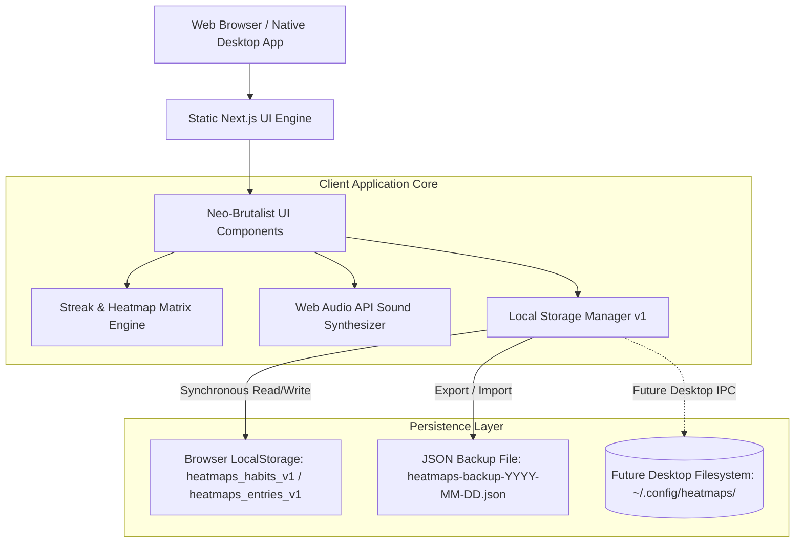
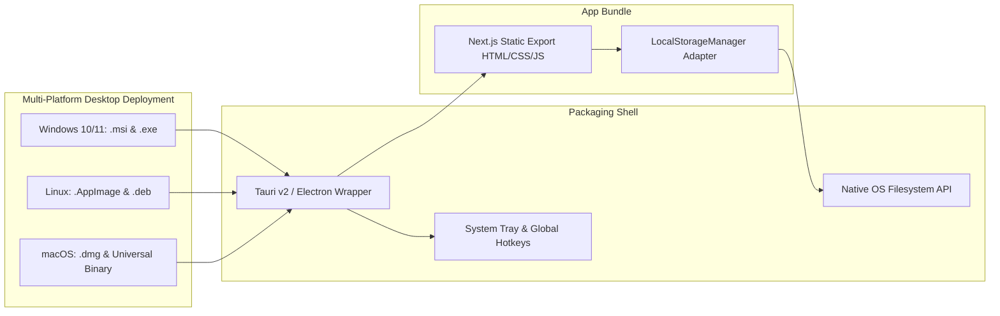

# System Design & Architecture Specification — HeatMaps

## 1. Executive Summary
**HeatMaps** is an offline-first, privacy-respecting habit tracking application with an electric Neo-Brutalist design language and GitHub contribution streak box heatmaps:
- **Architecture:** **100% Local-First & Zero Cloud Database.** All habit tracking data is persisted on the user's physical machine (Browser LocalStorage and future native Desktop Filesystem store). MongoDB and cloud databases have been completely eliminated.
- **Frontend Engine:** Next.js 16 (App Router, Turbopack, React 19) generating purely static pre-rendered pages.
- **Visual Design:** Neo-Brutalism with high-contrast solid borders (`2.5px border-black`), offset drop shadows (`4px 4px 0px #000000`), and electric status accents.
- **Future Scope & Deployment Target:** Standalone cross-platform desktop application packaging for **Windows** (`.msi`, `.exe`), **Linux** (`.AppImage`, `.deb`), and **macOS** (`.dmg`) using Tauri or Electron.

---

## 2. High-Level Component Flow



---

## 3. Data Schema & Local Storage Engine

### A. Habit Entity Model
```typescript
interface HabitData {
  id: string; // Unique timestamp/UUID e.g. 'habit-1728300000'
  title: string;
  description?: string;
  category: string;
  color: string;
  type: 'boolean' | 'numeric';
  targetValue?: number;
  unit?: string;
  twoDayRule: boolean;
  needsTimer?: boolean; // When true, habit is tracked in focus timer and unit is automatically locked to minutes
  habitLoop?: {
    cue?: string;
    routine?: string;
    reward?: string;
    sanction?: string;
  };
  archived?: boolean;
}
```

### B. Daily Habit Entry Entity Model
```typescript
interface EntryData {
  date: string; // ISO format 'YYYY-MM-DD' (local calendar date)
  status: 'check' | 'fail' | 'skip' | 'progress';
  value?: number;
  notes?: string;
}
```

### C. Universal Backup Schema (`HeatmapsBackupData`)
```typescript
interface HeatmapsBackupData {
  version: 1;
  exportedAt: string; // ISO timestamp
  source: 'HeatMaps Local-First App';
  habits: HabitData[];
  entries: Record<string, Record<string, EntryData>>; // { [habitId]: { [dateStr]: EntryData } }
}
```

---

## 4. GitHub Contribution Matrix Architecture

1. **Grid Dimension:** 52 columns × 7 rows = 364–366 days.
2. **Date Normalization:** All date lookups strictly use `'YYYY-MM-DD'` local calendar keys, preventing timezone conversion drifts.
3. **Responsive Adaptation:**
   - **Desktop (>=768px):** Full 52-week year matrix rendered with non-overlapping month markers.
   - **Mobile (<768px):** Rolling 90-day matrix (13 weeks) fitting naturally on 375px–430px viewports, with a 1-tap `[ 90D ] [ 365D ]` switcher for full horizontal scroll.
4. **Streak Math & Two-Day Rule:**
   - Active streak increments on `check` days.
   - `skip` days pause the streak without resetting it to zero.
   - If `habit.twoDayRule === true`, missing an isolated single day preserves the streak if the immediately following day is completed.

---

## 5. Procedural Web Audio Engine & Offline IndexedDB Storage Architecture

### A. Procedural Audio Synthesis (Zero Network Dependency)
- **Engine:** Pure Web Audio API graphs synthesized on the fly:
  - *Noise Generators:* White noise buffer passed through recursive low-pass `BiquadFilterNode` chains with pinking/browning curves.
  - *Binaural Alpha/Gamma Beat Engine:* Dual stereo oscillators tuned to $f_L = 200\text{Hz}$ and $f_R = 240\text{Hz}$ yielding pure 40Hz Gamma brainwave entrainment.
  - *Biophilic Generators:* Exponential envelope modulation simulating ocean tide swells and randomized raindrop burst oscillators.
  - *Chords & Pads:* Polyphonic additive detuned sine/triangle oscillators routed through low-pass resonant filters.

### B. Custom Audio IndexedDB Engine (`customAudioStorage.ts`)
- **Storage Subsystem:** Local browser IndexedDB database `heatmaps_audio_db` (ObjectStore `tracks`).
- **File Ingestion:** Reads user audio files (`.mp3`, `.wav`, `.ogg`, `.m4a`, etc.) directly into raw `Blob` objects.
- **Failover:** In environments without IndexedDB (e.g., restricted private windows), transparently falls back to an in-memory Map cache.

---

## 6. BrainDump Dual-Mode Workspace Architecture

### A. Two-Space Selection Router
- Visiting `/braindump` renders a dedicated **Workspace Chooser** giving the user two big options:
  1. **Daily Journal:** Routed to `/braindump?mode=journal`.
  2. **Notebook & Folders:** Routed to `/braindump?mode=notebook`.
- Deep linking to `/journal` executes an automatic client redirect to `/braindump?mode=journal`.

### B. Hierarchical File System Tree (`NotebookFolder` & `NotebookNote`)
- Simulates a real Linux desktop file manager (`/`, `/Projects`, `/Archive`, etc.):
  - Infinite subfolder recursion via `parentId` pointers.
  - Interactive double-clicking on folders opens them; clicking breadcrumbs navigates up the directory tree.
  - In-place creation, renaming, and deletion for folders and documents.

### C. Modular Notion / BlockSuite Architecture
- **Document Structure:** `BrainDoc` containing an ordered array of `BrainBlock` items.
- **Block Types:** `paragraph`, `heading1`, `heading2`, `heading3`, `todo`, `bullet`, `number`, `quote`, `code`, `callout`, `database`.
- **Inline Databases:** Relational block embedding custom columns (Text, Number, Select, Checkbox, Date), filtering, and automatic row aggregations (Sum, Average, Checked Count).

---

## 7. Desktop Keyboard Shortcuts & Mouse Multi-Selection Engine

### A. Multi-Action Undo/Redo Engine
- Maintains a 50-state immutable document history stack (`undoStackRef` and `redoStackRef`).
- State variables `canUndo` and `canRedo` ensure reactive, zero-lint-error disabled button rendering.
- `Ctrl+Z` / `Cmd+Z`: Reverts changes across blocks, content, and titles.
- `Ctrl+Y` / `Cmd+Y` / `Ctrl+Shift+Z`: Redoes undone document states.

### B. Clipboard Engine
- `Ctrl+C`: Serializes selected blocks into deep-cloned JSON in memory and writes formatted Markdown lines to `navigator.clipboard`.
- `Ctrl+V`: Deep clones clipboard blocks with freshly generated UUIDs (`createId('blk')`) and inserts them directly beneath active selection.

### C. Mouse Multi-Select & Canvas Marquee
- **Gutter Click:** Selects individual block.
- **Shift + Click:** Contiguous range selection between previously clicked block and current block.
- **Ctrl / Cmd + Click:** Toggles individual block in/out of selection.
- **Canvas Marquee Selection:** Clicking and dragging on the note background calculates an intersecting bounding rectangle (`getBoundingClientRect()`) and highlights all overlapping blocks in real time.

---

## 8. Future Desktop Application Architecture (Windows, Linux, macOS)

When HeatMaps transitions from web to desktop deployment, the architecture is designed for zero-refactor packaging:



1. **Packaging Target:** Next.js static HTML/JS export bundled inside a native lightweight shell (e.g. Tauri v2).
2. **Filesystem Adapter:** `LocalStorageManager` can connect via Tauri IPC to write directly to:
   - Windows: `%APPDATA%\HeatMaps\data.json`
   - Linux: `~/.config/heatmaps/data.json`
   - macOS: `~/Library/Application Support/HeatMaps/data.json`
3. **Offline Guarantee:** Zero network dependencies required to launch, run, or persist data.
4. **Desktop Features:** System tray minimization, launch-on-boot, and global shortcut check-ins.

---

## 9. Security & Privacy Guarantees
- **Zero-Knowledge / Zero-Server:** Since no user data or habit records are transmitted to a central database, data breach risk is zero.
- **Strict Headers:** CSP, HSTS, X-Content-Type-Options: nosniff, and X-Frame-Options: DENY.
- **Sanitized Backup Parsing:** JSON imports undergo structural verification to prevent prototype poisoning and injection attacks.
